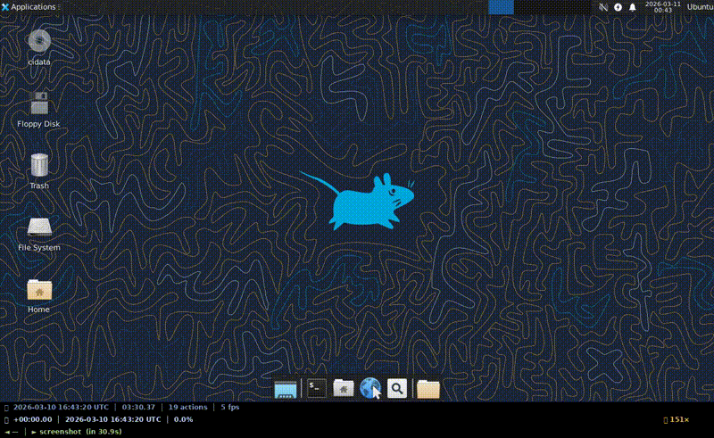

# Remote Desktop MCP

A Model Context Protocol (MCP) server for remote desktop control (Local, RDP, VNC, ADB). This allows AI models like Claude to see and interact with your desktop.



## Features

- **Screenshots**: Let the AI "see" your screen.
- **Interactions**: Mouse clicks, movement, scrolling, and keyboard typing.
- **Protocols**: Native support for Local Desktop, RDP, VNC, and Android Devices via ADB.
- **Recording**: Capture desktop sessions as video for demos, debugging, and trace replay.

## Quick Start

The easiest way to install this server is via the Gemini CLI:

```bash
# Local Desktop
gemini mcp add remote-desktop uvx remote-desktop-mcp mcp local

# Android (ADB)
gemini mcp add remote-desktop-vnc -- uvx remote-desktop-mcp mcp adb

# RDP
gemini mcp add remote-desktop-rdp \
    -e REMOTE_DESKTOP_RDP_HOST=192.168.1.1 \
    -e REMOTE_DESKTOP_RDP_USER=ubuntu \
    -e REMOTE_DESKTOP_RDP_PASSWORD=ubuntu \
    -- uvx remote-desktop-mcp mcp rdp

# VNC
gemini mcp add remote-desktop-vnc \
    -e REMOTE_DESKTOP_VNC_HOST=127.0.0.1:5900 \
    -e REMOTE_DESKTOP_VNC_PASSWORD=password \
    -- uvx remote-desktop-mcp mcp vnc
```
